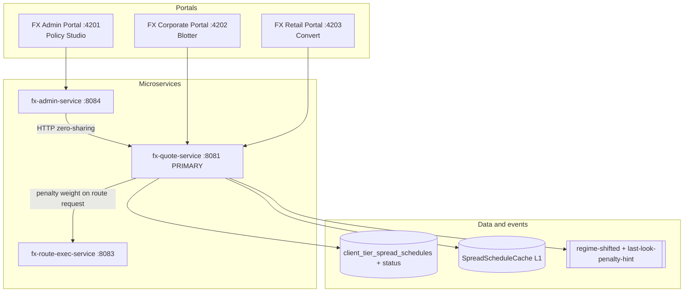

# Functional Requirement FR-01 — Session & Regime Guardrails

**Document ID:** FR-01  
**PRD:** [PRD-FX-SOR-001](../../PRD-FX-SOR-001.md) §4 / §4.1  
**Owner (primary):** `fx-quote-service`  
**Implementation status:** **DONE** (core path + portals wired; see Status columns below)  
**Last updated:** 2026-11-21  

## 1. Requirement statement

> **FR-01 Session & Regime Guardrails:** Automatically tighten spread tolerances and increase last-look penalties during NY rollover and high-impact macro releases (FOMC, NFP, ECB).

| Strategic pillar linkage | How FR-01 contributes | Status |
| :---- | :---- | :---- |
| **Margin Preservation** | Session-aware client markup avoids giving away spread in thin/volatile windows | DONE |
| **Execution Certainty** | Higher last-look penalties in rollover/macro reduce toxic LP preference downstream | DONE |
| **Low-Latency Decisioning** | Regime + markup resolved from L1 schedule cache on the quote hot path | DONE |
| **Policy Agility** | Desk updates tier×pair×regime schedules without redeploying quote pods | DONE |
| **Regulatory Provenance** | Regime-shift events and quote responses carry `sessionRegime` for audit | DONE |

---

## 2. Portals involved (explicit)

| Portal | URL (local) | FR-01 role | Screens / actions | Backend | Status |
| :---- | :---- | :---- | :---- | :---- | :---- |
| **FX Admin Portal** | http://localhost:4201 | **Configure & govern** | **Policy Studio** — draft/submit/approve `client_tier_spread_schedules`; Arm/Clear MACRO_NEWS | `fx-admin-service` `:8084` → quote | DONE |
| **FX Corporate Portal** | http://localhost:4202 | **Exercise & observe** | **Blotter** — live indicative + regime context + rates | `fx-quote-service` `:8081` | DONE |
| **FX Retail Portal** | http://localhost:4203 | **Exercise (retail tier)** | **Convert** — all-in markup / regime / last-look weight | `fx-quote-service` `:8081` | DONE |

**Portal split:** Admin = write/configure · Corporate + Retail = read/consume.

---

## 3. Architecture diagram

### 3.1 Image

### 3.2 Logical flow (Mermaid)

---

## 4. Microservices impacted

| Impact | Microservice | Role | Status |
| :---- | :---- | :---- | :---- |
| **Primary** | `fx-quote-service` | Regime detect; markup × news; schedule CRUD; macro flag; L1 cache; events | DONE |
| **Secondary** | `fx-admin-service` | Proxy schedule draft/submit/approve; macro arm; invalidate → quote | DONE |
| **Downstream** | `fx-route-exec-service` | Apply `lastLookPenaltyWeight` / `sessionRegime` in splits + provenance | DONE |
| **Assist** | `fx-agent-orchestrator-service` | MacroGuard workflow (existing assist) | DONE (pre-existing) |
| **Portals** | Admin / Corporate / Retail | HTTP wired for FR-01 screens | DONE |

---

## 5. Data required

| Kind | What | Where | Status |
| :---- | :---- | :---- | :---- |
| **Configuration** | `client_tier_spread_schedules` (+ **`status`**: DRAFT / PENDING_APPROVAL / ACTIVE) | quote DB / Liquibase 001–003 | DONE |
| **System** | LP top-of-book | `QuoteBookCache` | DONE |
| **Transaction** | Indicative / stream / rates / regime context | quote APIs | DONE |
| **Event** | `fx.quote.regime-shifted.v1`, `fx.quote.last-look-penalty-hint.v1` | Kafka / log publisher | DONE |
| **Macro override** | In-memory `MacroRegimeFacade` flag | quote | DONE |

### Config row shape

| Field | Example | Status |
| :---- | :---- | :---- |
| `tier_id` | `TIER_1`…`TIER_3` | DONE |
| `ccy_pair` | `EURUSD` | DONE |
| `session_regime` | `TOKYO`, `LONDON_NY_OVERLAP`, `NY_ROLLOVER`, `MACRO_NEWS_HIGH` | DONE |
| `markup_bps` | seeded matrix | DONE |
| `news_multiplier` | applied as `markup × news` | DONE |
| `status` | DRAFT / PENDING_APPROVAL / ACTIVE | DONE |
| `effective_from`, `approved_by` | maker-checker trail | DONE |

---

## 6. API endpoints

| Service | Method | Endpoint | Portal | Status |
| :---- | :---- | :---- | :---- | :---- |
| quote | `POST` | `/api/v1/fx/quotes/indicative` | Corporate / Retail | DONE |
| quote | `GET` | `/api/v1/fx/quotes/stream` | Corporate | DONE |
| quote | `GET` | `/api/v1/fx/rates/{ccyPair}` | Corporate / Retail | DONE |
| quote | `GET` | `/api/v1/fx/regime/context` | Corporate / Retail | DONE |
| quote | `GET` | `/api/v1/fx/spread-schedules` | Admin (via admin proxy) | DONE |
| quote | `POST` | `/api/v1/fx/spread-schedules/draft\|submit\|approve` | Admin | DONE |
| quote | `POST` | `/api/v1/fx/spread-schedules/cache/invalidate` | Admin | DONE |
| quote | `PUT`/`DELETE`/`GET` | `/api/v1/fx/macro-flag` | Admin | DONE |
| admin | `GET`/`POST` | `/api/v1/admin/spread-schedules*` | Admin Policy Studio | DONE |
| admin | `POST`/`DELETE` | `/api/v1/admin/macro-flag` | Admin Policy Studio | DONE |
| admin | `POST` | `/api/v1/admin/cache/invalidate` | Admin (also hits quote L1) | DONE |
| route-exec | `POST` | `/api/v1/fx/orders/route-execute` (+ `sessionRegime`, `lastLookPenaltyWeight`) | Downstream | DONE |

---

## 7. Functional components, facades, DAO, business logic

### 7.1 Components by layer

| Layer | Component | Status |
| :---- | :---- | :---- |
| Presentation | `QuoteController` (+ schedule/macro/regime APIs) | DONE |
| Presentation | `AdminController` schedule/macro proxies | DONE |
| Presentation | Admin Policy Studio / Corporate Blotter / Retail Convert | DONE |
| Business | `QuotePricingFacade` | DONE |
| Business | `MacroRegimeFacade` | DONE |
| Business | `SpreadScheduleAdminFacade` | DONE |
| Services | `SpreadScheduleCache` L1 | DONE |
| Services | `DomainEventPublisher` regime + last-look hint | DONE |
| Persistence | `ClientTierSpreadSchedule` + `status` + Liquibase 003 | DONE |
| Downstream | `RouteExecService` penalty-aware splits | DONE |

### 7.2 Facade tasks

| Facade | Task | Status |
| :---- | :---- | :---- |
| `QuotePricingFacade` | `resolveActiveRegime()` (clock + macro) | DONE |
| `QuotePricingFacade` | `resolveEffectiveMarkup()` = markup × news | DONE |
| `QuotePricingFacade` | `priceIndicative` / `streamMarkedTicks` / `rates` | DONE |
| `QuotePricingFacade` | `emitRegimeShiftIfChanged` / `publishLastLookPenaltyHint` | DONE |
| `SpreadScheduleAdminFacade` | draft / submit / approve / invalidate | DONE |
| `MacroRegimeFacade` | ingest / clear / current | DONE |
| Route-exec | apply penalty weight in `buildSplits` + provenance | DONE |

### 7.3 DB tables & DAO CRUD

| Table / store | CRUD | Status |
| :---- | :---- | :---- |
| `client_tier_spread_schedules` | R/C/U via repository + admin facade; **status** column | DONE |
| Liquibase `003-spread-schedule-status-and-macro-seed` | status column + MACRO_NEWS / tier matrix seed | DONE |
| `SpreadScheduleCache` | warm / invalidate / put | DONE |
| Macro flag (in-memory) | set / clear | DONE |

### 7.4 Business logic checklist

| # | Rule | Status |
| :---- | :---- | :---- |
| 1 | Detect Tokyo / London–NY / NY rollover | DONE |
| 2 | Detect macro (FOMC/NFP/ECB) via macro flag → `MACRO_NEWS_HIGH` | DONE |
| 3 | Lookup `markup_bps` by tier×pair×regime | DONE |
| 4 | Apply `news_multiplier` | DONE |
| 5 | Widen client spread in thin/risky sessions (seeded) | DONE |
| 6 | Increase last-look penalties for route-exec | DONE |
| 7 | Emit regime-shift event | DONE |
| 8 | L1 schedule cache + invalidate | DONE |
| 9 | Maker-checker schedule updates (draft/submit/approve) | DONE |
| 10 | Portal invocation (Admin / Corporate / Retail) | DONE |

---

## 8. Practical sequence (portals)

1. Restart middleware so Liquibase 003 + new facades load (`npm run local:middleware:all:stop` then `start`).  
2. **Admin** http://localhost:4201/policy-studio — refresh schedules; draft/approve; optional Arm MACRO_NEWS.  
3. **Corporate** http://localhost:4202/blotter — Refresh quote; note regime + markup.  
4. **Retail** http://localhost:4203/convert — Refresh; note tier markup vs regime.  
5. Optional Swagger: route-execute with `sessionRegime` + `lastLookPenaltyWeight` from `/regime/context`.

---

## 9. One-line ownership

| Concern | Owner | Status |
| :---- | :---- | :---- |
| Runtime markup + regime | `fx-quote-service` | DONE |
| Schedule approve / macro / invalidate | `fx-admin-service` + Admin portal | DONE |
| Customer quote | Corporate + Retail portals → quote | DONE |
| Last-look penalty consumption | `fx-route-exec-service` | DONE |

---

## 10. Package / design compliance

| Rule | How FR-01 complied | Status |
| :---- | :---- | :---- |
| Neal Ford closed layers | Facades under `business.facade`; controller → service → facade → cache/repo | DONE |
| Zero-sharing | Admin uses `QuoteScheduleClient` HTTP only | DONE |
| Existing package roots | `…quote`, `…admin`, `…exec`; portals under `Portals/*` | DONE |

---

## 11. References

- [PRD-FX-SOR-001](../../PRD-FX-SOR-001.md)  
- [API & Data Model Spec](../Specs/API-and-DataModel-Spec.md)  
- [Apps_Runbook.md](../../Apps_Runbook.md)  
