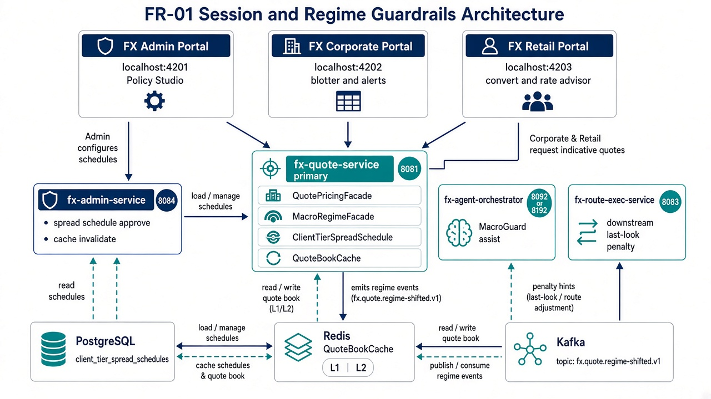
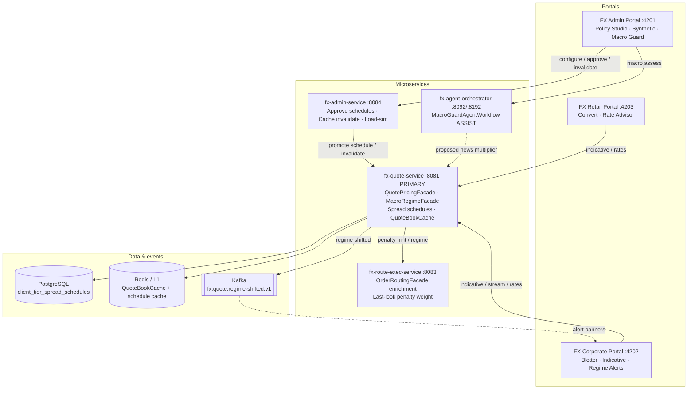

# Functional Requirement FR-01 — Session & Regime Guardrails

**Document ID:** FR-01  
**PRD:** [PRD-FX-SOR-001](../../PRD-FX-SOR-001.md) §4 / §4.1  
**Owner (primary):** `fx-quote-service`  
**Status:** Partially implemented (clock-based session markup + seed schedules); gaps called out below  

## 1. Requirement statement

> **FR-01 Session & Regime Guardrails:** Automatically tighten spread tolerances and increase last-look penalties during NY rollover and high-impact macro releases (FOMC, NFP, ECB).

| Strategic pillar linkage | How FR-01 contributes |
| :---- | :---- |
| **Margin Preservation** | Session-aware client markup avoids giving away spread in thin/volatile windows |
| **Execution Certainty** | Higher last-look penalties in rollover/macro reduce toxic LP preference downstream |
| **Low-Latency Decisioning** | Regime + markup resolved from L1 schedule cache on the quote hot path |
| **Policy Agility** | Desk updates tier×pair×regime schedules without redeploying quote pods |
| **Regulatory Provenance** | Regime-shift events and quote responses carry `sessionRegime` for audit |

---

## 2. Portals involved (explicit)

FR-01 is **not** admin-only and **not** customer-only. Both sides participate:

| Portal | URL (local) | FR-01 role | Screens / actions | Backend called |
| :---- | :---- | :---- | :---- | :---- |
| **FX Admin Portal** | http://localhost:4201 | **Configure & govern** | **Policy Studio** — draft/approve `client_tier_spread_schedules` (markup_bps, news_multiplier per tier×pair×regime); **Synthetic & Chaos** — load-sim with named `regime`; **Agent Orchestrator** — Macro Guard assess; **Command Center** — cache invalidate after promote | `fx-admin-service` `:8084`; agents `:8092` / Python `:8192` |
| **FX Corporate Portal** | http://localhost:4202 | **Exercise & observe** | **Multi-LP Depth Blotter** / indicative quote — request rates with `clientTier`; **Alerts** — subscribe to regime / macro volatility banners (SSE from quote); **TCA / copilot** — show regime on pre-trade context | `fx-quote-service` `:8081` (`/quotes/indicative`, `/quotes/stream`, `/rates/{ccyPair}`) |
| **FX Retail Portal** | http://localhost:4203 | **Exercise (retail tier)** | **Convert** / **Rate Advisor** — all-in rate reflects retail tier markup under current session; timing tips when regime widens spreads | `fx-quote-service` `:8081` |

**Portal split in one line**

- **Admin portal** = *write/configure* FR-01 policy (schedules, approve, invalidate, macro assist).  
- **Corporate + Retail portals** = *read/consume* FR-01 (quotes priced with session/macro markup; alerts when regime shifts).

> **Current gap:** Admin Command Center / Policy Studio / Corporate blotter are largely UI shells today. APIs on quote/admin exist for the hot path; schedule CRUD + portal HTTP wiring are still to be completed (see §8).

---

## 3. Architecture diagram

### 3.1 Image



### 3.2 Logical flow (Mermaid)



---

## 4. Microservices impacted

| Impact | Microservice | Role for FR-01 |
| :---- | :---- | :---- |
| **Primary (must)** | `fx-quote-service` | Detect session/macro regime; apply tier×pair×regime markup; emit regime events |
| **Secondary (policy write path)** | `fx-admin-service` | Maker-checker approve/promote spread schedules; cache invalidate; synthetic load by regime |
| **Downstream consumer (light)** | `fx-route-exec-service` | Enrichment reads active regime / higher last-look penalty weight when scoring |
| **Assist only** | `fx-agent-orchestrator-service` | `MacroGuardAgentWorkflow` proposes news severity / multipliers |
| **Portal UX** | Admin + Corporate + Retail | See §2 |
| **Not FR-01 core** | `fx-qualify-service`, topology / MCP | Credit/settlement / ops — no ownership of session markup |

**PRD name map:** pricing → `fx-quote-service`.

---

## 5. Data required

| Kind | What | Where | Who updates |
| :---- | :---- | :---- | :---- |
| **Configuration (master)** | Client-tier spread schedules: markup for each **tier × pair × session regime** | DB `client_tier_spread_schedules` on quote | **Admin portal** (Policy Studio) / Liquibase seed |
| **System / reference** | LP top-of-book (bid/ask/size/TTL) | `QuoteBookCache` (in-mem / Redis) | Market data / synthetic — not customer portal |
| **Transaction (runtime)** | Indicative / stream / rates with `clientTier`, `ccyPair`, `side`, `notional` | HTTP quote `:8081` | **Corporate / Retail portals** |
| **Event / audit** | Regime change notices | Kafka `fx.quote.regime-shifted.v1` | Emitted by quote (no portal write) |
| **Assist** | Macro/news severity → suggested multipliers | Macro Guard agent | **Admin portal** agent screen |

### Config row shape

| Field | Example | Role |
| :---- | :---- | :---- |
| `tier_id` | `TIER_1`, `TIER_2` | Who the client is |
| `ccy_pair` | `EURUSD` | Pair |
| `session_regime` | `TOKYO`, `LONDON_NY_OVERLAP`, `NY_ROLLOVER`, `MACRO_NEWS_HIGH` | Guard bucket |
| `markup_bps` | `0.75` … `2.0+` | Spread widen/tighten |
| `news_multiplier` | `1.00`–`1.25+` | FOMC/NFP-style scale |
| `effective_from`, `approved_by` | policy provenance | Maker-checker trail |

**Regimes recognized today (UTC hour in code):** `TOKYO` (00–07), `LONDON_NY_OVERLAP` (12–16), `NY_ROLLOVER` (≥21), else default `LONDON_NY_OVERLAP`. Macro regimes are required for full FR-01.

---

## 6. API endpoints

| Service | Method | Endpoint | Purpose | Portal | Status |
| :---- | :---- | :---- | :---- | :---- | :---- |
| quote | `POST` | `/api/v1/fx/quotes/indicative` | Apply regime markup → executable rate | Corporate / Retail | Exists |
| quote | `GET` | `/api/v1/fx/quotes/stream` | SSE ticks with regime + markup | Corporate (blotter/alerts) | Exists |
| quote | `GET` | `/api/v1/fx/rates/{ccyPair}` | Snapshot + `sessionRegime` | Corporate / Retail | Exists |
| quote | `GET` | `/api/v1/fx/spread-schedules` *(proposed)* | List schedules | Admin Policy Studio | Need |
| quote / admin | `POST`/`PUT` | `/api/v1/admin/spread-schedules` *(proposed)* | Upsert schedule (maker) | Admin | Need |
| admin | `POST` | `/api/v1/admin/spread-schedules/{id}/approve` *(proposed)* | Checker promote | Admin | Need |
| admin | `POST` | `/api/v1/admin/cache/invalidate` | Refresh L1 after promote | Admin | Exists |
| admin | `POST` | `/api/v1/admin/synthetic/load-sim/trigger` | Stress under named `regime` | Admin Synthetic | Exists |
| agent | `POST` | `/api/v1/agents/macro-guard/assess` | Propose news multiplier | Admin Agents | Exists (assist) |

### Example customer request (Corporate / Retail → quote)

```http
POST http://localhost:8081/api/v1/fx/quotes/indicative
Content-Type: application/json

{
  "clientId": "CORP-100",
  "clientTier": "TIER_2",
  "ccyPair": "EURUSD",
  "side": "BUY",
  "notional": 1000000,
  "tenor": "SPOT"
}
```

Expect wider `markupBps` under `NY_ROLLOVER` / `TOKYO` / macro than under `LONDON_NY_OVERLAP` for the same tier (per schedule rows).

---

## 7. Functional components, facades, DAO, business logic

### 7.1 Components by layer

| Layer | Component | Status |
| :---- | :---- | :---- |
| Presentation | `QuoteController` | Exists |
| Presentation | Admin Policy / SpreadSchedule APIs | Need |
| Presentation | Admin / Corporate / Retail portal HTTP clients | Need (shells today) |
| Business | `QuotePricingFacade` (extract from fat `QuoteService`) | Need |
| Business | `SpreadScheduleAdminFacade` | Need |
| Business | `MacroRegimeFacade` | Partial (clock only) |
| Domain | Session regime detector | Exists — extend for `MACRO_NEWS_*` |
| Domain | Markup resolver (`markup_bps × news_multiplier`) | Partial (`markup_bps` only today) |
| Domain | Regime-shift publisher | Exists |
| Domain | Last-look penalty hint for route-exec | Need |
| Persistence | `ClientTierSpreadSchedule` + repository | Exists (read + Liquibase seed) |
| Cache | Schedule L1 + invalidate | Need (hot path still hits JPA) |

### 7.2 Facade tasks

#### `QuotePricingFacade` (hot path — primary)

| Task | Logic |
| :---- | :---- |
| `resolveActiveRegime()` | UTC session map + optional macro override |
| `resolveEffectiveMarkup(tier, pair, regime)` | `markup_bps * news_multiplier` |
| `priceIndicative(request)` | Top-of-book ± markup; return quoteId, rate, markup, regime |
| `streamMarkedTicks(...)` | Same markup on each LP tick |
| `emitRegimeShiftIfChanged(...)` | Publish `fx.quote.regime-shifted.v1` |
| `publishLastLookPenaltyHint(regime)` | Higher penalty in rollover/macro for route-exec |

#### `SpreadScheduleAdminFacade` (Admin portal write path)

| Task | Logic |
| :---- | :---- |
| `draftSchedule(row)` | Insert pending / versioned row |
| `submitForChecker(...)` | Four-eyes queue |
| `approveAndActivate(...)` | Set `approved_by`, `effective_from`; invalidate L1 |
| `listByPairTierRegime(...)` | Policy Studio read |
| `seedCatalog(...)` | Synthetic tier×pair×regime matrix |

#### `MacroRegimeFacade` (Admin Macro Guard → quote)

| Task | Logic |
| :---- | :---- |
| `ingestMacroFlag(source, severity)` | Activate news regime / multiplier |
| `clearMacroFlag()` | Revert to clock session |

#### Route-exec (downstream)

| Task | Logic |
| :---- | :---- |
| `OrderRoutingFacade.enrichment()` | Read current regime / penalty hint |
| Scoring | Raise last-look penalty when regime ∈ `{NY_ROLLOVER, MACRO_NEWS_*}` |

### 7.3 DB tables & DAO CRUD

| Table / store | Owner | CRUD | Notes |
| :---- | :---- | :---- | :---- |
| `client_tier_spread_schedules` | quote | **R** exists; **C/U** via admin path | PK `(tier_id, ccy_pair, session_regime)` |
| Liquibase `001` / `002` | quote | Seed | Expand beyond EURUSD |
| `spread_schedule_change_requests` *(proposed)* | admin/quote | CRUD | Maker-checker drafts |
| `macro_regime_flags` or Redis key *(proposed)* | quote | C/U/D | FOMC/NFP override + expiry |
| `QuoteBookCache` | quote | put/get | Market book |
| Caffeine L1 schedule cache | quote | load-all / invalidate | Zero hot-path SQL (spec) |

**DAO:** `ClientTierSpreadScheduleRepository` — exists read methods; add save/list + cache-backed DAO. Prefer quote-owned admin APIs (zero-sharing) rather than admin writing quote’s DB directly.

### 7.4 Business logic checklist

| # | Rule | Today | To meet FR-01 fully |
| :---- | :---- | :---- | :---- |
| 1 | Detect Tokyo / London–NY / NY rollover | Done | Keep + tests |
| 2 | Detect macro (FOMC/NFP/ECB) | Missing | Flag store + `MACRO_NEWS_*` rows |
| 3 | Lookup `markup_bps` by tier×pair×regime | Done | Expand seed matrix |
| 4 | Apply `news_multiplier` | Column unused | `effective = markup_bps × news_multiplier` |
| 5 | Widen client spread in thin sessions | Via higher markup rows | Ensure rollover/macro > overlap |
| 6 | Increase last-look penalties | Not wired to route-exec | Penalty hint + scoring |
| 7 | Emit regime-shift event | Done | Corporate alerts consume |
| 8 | L1 schedule cache + invalidate | Spec only | Implement |
| 9 | Maker-checker schedule updates | Missing | Admin APIs + **Admin portal** |
| 10 | Portal invocation | Not wired | **Corporate/Retail** → quote; **Admin** → schedules |

---

## 8. Practical sequence (portals first)

1. **Admin portal** — ensure/seed schedule rows (Policy Studio / Liquibase); invalidate cache after change.  
2. **Corporate / Retail portal** — same `clientTier`, request indicative quote; compare `sessionRegime` + `markupBps` across sessions (or wait for UTC window / load-sim regime).  
3. **Admin portal** — optional Macro Guard assess → apply news multiplier; Synthetic load-sim with `NY_ROLLOVER` / macro.  
4. Confirm Kafka `fx.quote.regime-shifted.v1` and (when wired) Corporate alert banners.  
5. Confirm route-exec scoring uses elevated last-look penalty in those regimes.

---

## 9. One-line ownership

| Concern | Owner |
| :---- | :---- |
| Runtime markup + regime detection | `fx-quote-service` |
| Schedule approve / invalidate / load-sim | `fx-admin-service` + **Admin portal :4201** |
| Customer quote / alerts | **Corporate :4202** + **Retail :4203** → quote APIs |
| Macro proposal | Agent orchestrator (assist) via **Admin portal** |
| Last-look penalty consumption | `fx-route-exec-service` |

---

## 10. References

- [PRD-FX-SOR-001](../../PRD-FX-SOR-001.md) — §1 pillars, §4 FR-01, §4.1 ownership map  
- [API & Data Model Spec](../Specs/API-and-DataModel-Spec.md)  
- [Full System Architecture & Admin Spec](../Specs/Full-System-Architecture-and-Admin-Spec.md)  
- [Angular AI Portals Spec](../Specs/Angular-AI-Portals-Admin-Corporate-Retail-Spec.md)  
- [Synthetic Data Catalog](../Specs/Synthetic-Data-Catalog-and-Seeding-Spec.md)  
- Apps runbook: [Apps_Runbook.md](../../Apps_Runbook.md)  
