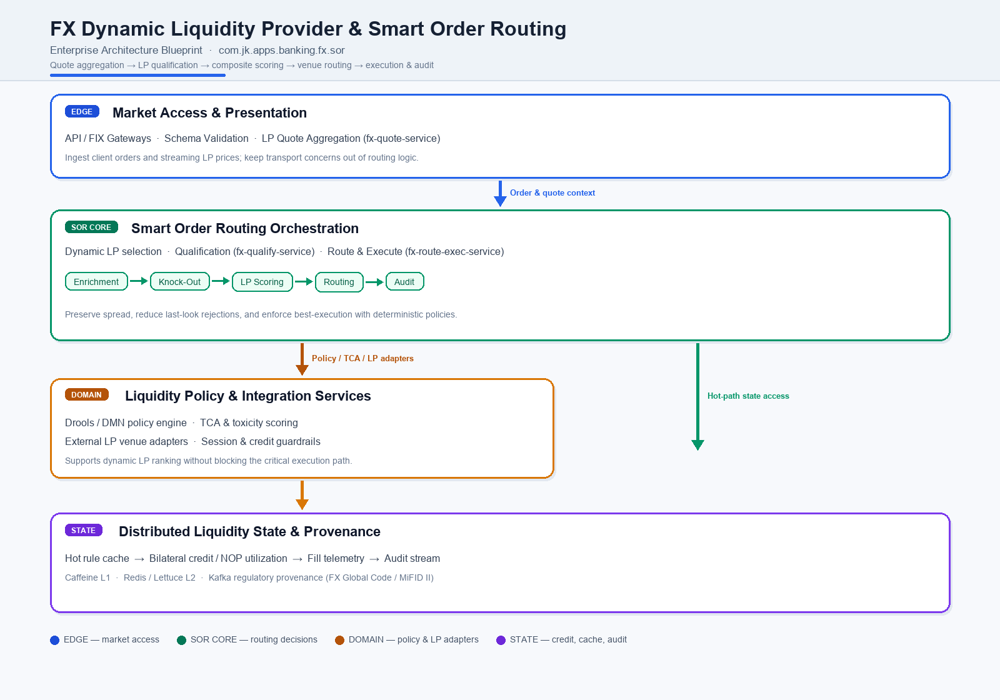

# **FX Dynamic Liquidity & Smart Order Routing Engine**

**Target Namespace:** com.jk.apps.banking.fx.sor  
**Architecture Style:** Dynamic Liquidity Provider & Smart Order Routing (SOR)  
**Domain:** Institutional & Commercial Foreign Exchange (FX) / Liquidity Execution  
*A deterministic, policy-driven Foreign Exchange (FX) qualification and Smart Order Routing (SOR) platform designed for a major U.S. Tier-1 Commercial & Investment Bank to eliminate spread leakage, mitigate last-look rejections, and guarantee regulatory best execution in sub-10 milliseconds.*

**Table of Contents**

> * [Understanding the Dynamic Liquidity Provider & FX Routing Domain](#bookmark=id.863vjn2fswql)  
> * [What is Smart Order Routing (SOR) — Knowledge Base](#what-is-smart-order-routing-sor--knowledge-base)
> * [1\. Business Context & Problem Statement](#bookmark=id.akvjtn4rwvrb)  
> * [2\. Strategic Value & Business Outcomes](#bookmark=id.t0bam69r4fwv)  
> * [3\. Core Domain Capabilities](#bookmark=id.1plpw3kv7eil)  
> * [4\. Enterprise Architecture Blueprint](#bookmark=id.yr40gh4s6wxt)  
> * [4.1 Maven Reactor Monorepo (Zero-Sharing Modules)](#41-maven-reactor-monorepo-zero-sharing-modules)
> * [5\. Technology & Resilience Pillars](#bookmark=id.w8py2shsa0yh)
> * [6\. High-Throughput Runtime & Kubernetes Topology](#bookmark=id.w8py2shsa0yh)  
> * [7\. Governance & Documentation](#bookmark=id.k82zljo3w3e9)

**Understanding the Dynamic Liquidity Provider & FX Routing Domain**

This platform is architected for a **major U.S. Tier-1 Commercial & Investment Bank** serving Fortune 500 corporate treasuries, multinational importers and exporters, institutional asset managers, and commercial middle-market clients across New York, London, and Singapore trading desks.

| Domain Concept | Executive Definition & How It Works at a Major U.S. Bank |
| :---- | :---- |
| **Why FX Has No Centralized Exchange (Unlike NASDAQ or NYSE)** | Equities trade on centralized exchanges like **NASDAQ** or the **NYSE**, where buyers and sellers meet in one regulated order book with a single official price. **Spot FX has no single global exchange.** Instead, FX is a decentralized, 24/5 Over-The-Counter (OTC) network where prices are quoted simultaneously across competing global banks, quantitative non-bank market makers, and Electronic Communication Networks (ECNs). Because there is no single official price screen, a U.S. bank must continuously aggregate and compare fragmented liquidity pools in real time. |
| **Liquidity Provider (LP)** | Wholesale currency market makers—such as fellow Tier-1 global banks, electronic market makers, and anonymous ECNs—that stream continuous two-way prices (Bid to buy, Ask to sell) to our bank so we can source or offload currency exposure instantly. |
| **Dynamic Liquidity Provider** | Rather than locking a currency pair to a fixed counterparty, a **Dynamic LP** model continuously re-evaluates which LP is the strongest partner at that exact millisecond based on live spread competitiveness, current trading session (New York, London, Tokyo), ticket size, bilateral credit availability, and recent fill reliability. |
| **Spread Leakage** | Invisible revenue loss that occurs when our bank quotes a tight rate to a corporate client expecting to cover that trade wholesale at a profit, but static or slow routing sends the order to an LP offering a wider spread—giving away our margin on the trade. |
| **Last-Look Rejections** | A wholesale FX practice where an LP displays a streaming price, our bank submits an order at that price, and the LP holds the order for a brief window (10 ms to 200 ms) before deciding whether to accept or reject it. If the market moves against the LP during that window, the LP rejects the trade—forcing our bank to re-route at a worse price. |
| **Slippage** | The negative price difference between the exchange rate available when a client order arrives and the actual rate achieved after routing delays, last-look rejections, or market movement across fragmented venues. |
| **Smart Order Routing (SOR)** | An automated execution capability that applies **configurable routing rules** and **real-time market intelligence** to decide where and how to place an order—or portions of an order—across one or many liquidity venues (in FX: LPs, ECNs, and the bank's internal principal book). |
| **Liquidity Fragmentation** | Liquidity no longer sits in one place. In equities it spans exchanges, dark pools, and ATS; in **FX** it spans competing bank LPs, non-bank market makers, and ECNs. Without intelligent routing, desks miss available liquidity, take unnecessary market impact, or accept suboptimal prices. |
| **Order Slicing (Child Orders)** | Breaking a large institutional parent order into smaller child clips routed across ranked LPs/venues to reduce signaling risk and market impact while raising fill probability. |
| **Internalization** | Matching client flow against the bank's own principal inventory or opposing client flow when safe—before hedging externally—reducing external venue fees and last-look exposure. |
| **Best Execution** | The regulatory and commercial duty to pursue the best available result for the client on a consistent basis (price, cost, speed, likelihood of fill). SOR provides the **auditability and TCA evidence** desks need for FX Global Code / MiFID II-style obligations. |
| **TCA (Transaction Cost Analysis)** | Post-trade (and increasingly pre-trade) analytics that measure slippage, fill quality, venue/LP toxicity, and routing effectiveness so desks can prove and improve best execution. |

**What is Smart Order Routing (SOR) — Knowledge Base**

Smart Order Routing is a core component of the institutional execution stack (alongside OMS/EMS). Rather than sending a full ticket to a single pre-assigned venue, a modern SOR continuously evaluates **where liquidity exists**, **how it can be accessed**, and **which execution tactic** best meets the desk's policy for that clip.

### Why SOR matters for FX desks (New York, London, Singapore)

FX is fragmented by design: there is no single global exchange for spot. Liquidity is quoted simultaneously across Tier-1 bank LPs, quantitative market makers, and ECNs. Static “always route EURUSD to LP\_X” tables create spread leakage, last-look churn, and credit/NOP rejects. Dynamic SOR + Dynamic LP selection is how eFX franchises protect margin and STP fill ratios under Tokyo / London–NY overlap / FOMC–NFP regimes.

### How this platform's SOR works (mechanics)

| SOR Building Block | What it does in industry practice | How this engine implements it |
| :--- | :--- | :--- |
| **Configurable routing rules** | Eligible venues, size thresholds, internalization preference, fallback/waterfall behaviour | Drools/DMN policy tables + knock-out rules in `fx-qualify-service` / `fx-route-exec-service` with maker-checker hot reload |
| **Real-time market intelligence** | Bid/ask, depth, venue latency, liquidity availability, restrictions | LP quote aggregation & session regime guards in `fx-quote-service` (Caffeine L1 + optional Redis L2) |
| **Execution tactics & order slicing** | Child orders, IOC/limit-style venue interaction, multi-venue sweep | Single-LP best-ex, multi-LP sweep, and waterfall failover inside the OrderRoutingFacade pipeline |
| **Risk & governance controls** | Pre-trade credit/compliance checks, venue eligibility, immutable audit trails | Bilateral credit/NOP checks, restricted-ccy escalation, Kafka provenance (FX Global Code / MiFID II RTS-27/28) |
| **Adaptive venue intelligence** | Refine routing from historical fill quality / toxicity rather than static rank alone | Composite LP scoring using fill ratio, last-look hold latency, and markout toxicity projections |

### SOR vs algorithmic trading

| Concern | Smart Order Routing (SOR) | Algorithmic trading |
| :--- | :--- | :--- |
| **Primary job** | *Where* (and to which venues/LPs) liquidity is accessed | *How* a parent order is worked over time (TWAP/VWAP-style schedules, participation) |
| **Typical output** | Venue/LP selection, child splits, failover path | Schedule of child releases into the market |
| **In this repo** | Core product — Dynamic LP qualification + routing facade | Can sit upstream/downstream; SOR remains the venue-selection brain |

The two are complementary: algos often **call** a SOR for each child clip.

### Benefits this knowledge base emphasizes

> * **Improved execution quality** — compete across fragmented LP prices instead of a static map.  
> * **Lower market impact** — slice institutional blocks; avoid signaling a full notional to one venue.  
> * **Consistency & repeatability** — desk policy encoded as versioned rules, not tribal knowledge.  
> * **Auditability & best-execution evidence** — every decision leaves a TCA-ready provenance trace.  
> * **Operational flexibility** — session/news regimes and LP kill-switches without multi-week releases.

### What institutional buyers look for (mapped to this repo)

| Selection criterion | Platform response |
| :--- | :--- |
| Real-time market intelligence | Streaming quote aggregation + session/microstructure awareness |
| Configurable routing logic | Externalized Drools/DMN + knock-out policies |
| Low-latency infrastructure | Java 21 virtual threads, Generational ZGC, eBPF/Cilium, horizontal pod scale |
| Integrated TCA / best-ex reporting | Async Kafka audit stream + order trace APIs |
| Scalability across global desks | NY / London / Singapore session matrices; 50–150+ pod topology |
| Governance | Maker-checker policy changes; dealing-desk escalation for exceptions |

*Industry framing for SOR mechanics is aligned with public market-structure explainers such as [Quod Financial — What is Smart Order Routing (SOR)?](https://www.quodfinancial.com/what-is-smart-order-routing-sor/); this repository applies those principles specifically to **institutional FX Dynamic Liquidity Provider** routing.*

**1\. Business Context & Problem Statement**

As a **major U.S. Tier-1 Commercial & Investment Bank**, our electronic FX (eFX) franchise processes tens of billions of dollars in daily client volume—ranging from automated corporate treasury hedging and cross-border payroll settlements to institutional block executions.  
Relying on static routing tables—where orders for a given currency pair are always directed to a pre-assigned Liquidity Provider—creates three structural commercial penalties for the bank:

> 1. **Spread Leakage:** LP pricing competitiveness shifts continuously across global trading sessions (Tokyo, London/NY overlap, NY close) and U.S. macroeconomic releases (such as FOMC rate decisions and Non-Farm Payrolls). Static routing forces trades through venues offering wider spreads, silently eroding net profit per million traded.  
> 2. **Last-Look Rejections & Slippage:** Certain LPs exhibit elevated last-look rejection rates during volatile windows or for larger corporate ticket sizes. Each rejection forces an emergency re-route, introducing latency slippage and degrading institutional client fill ratios.  
> 3. **Bilateral Credit & Net Open Position (NOP) Exhaustion:** Routing order flow blindly without real-time visibility into Prime Broker give-up limits and bilateral credit lines leads to hard settlement rejections and costly manual dealing-desk intervention in New York and London.

The **FX Dynamic Liquidity & Smart Order Routing Engine** solves these challenges by evaluating every incoming order in real time against market microstructure regimes, bilateral credit limits, historical LP fill quality, and client tiering policies before executing on the optimal venue(s).

**2\. Strategic Value & Business Outcomes**

| Strategic Pillar | Business Impact for the Bank | Target Operational Benchmark |
| :---- | :---- | :---- |
| **Margin Preservation** | Eliminates spread leakage by dynamically selecting the tightest all-in wholesale liquidity | **\+0.35 to \+0.80 bps** net spread capture improvement per \$1M traded |
| **Execution Certainty** | Penalizes LPs with high last-look rejection rates and slow hold times | **\> 98.5%** first-pass Straight-Through Processing (STP) fill rate |
| **Low-Latency Decisioning** | Real-time rule qualification and composite LP ranking without blocking I/O | **\< 5 ms** internal decisioning (p99); **\< 15 ms** end-to-end |
| **Business Agility** | New York & London eFX desks adjust weights and session guardrails declaratively | **\< 5 minutes** zero-downtime policy updates (vs. multi-week release cycles) |
| **Regulatory Provenance** | Captures an immutable explainability trace for every routing decision | **100%** compliance with **FX Global Code**, **Dodd-Frank**, and **MiFID II RTS-27/28** |

**3\. Core Domain Capabilities**

> * **Session & Liquidity Regime Awareness:** Automatically adapts qualification rules across Wellington/Sydney open, Tokyo, London/Tokyo overlap, London/NY overlap, NY rollover (5:00 PM EST), and high-impact U.S. and global macro news windows.  
> * **Deterministic Knock-Out Qualification:** Instantly filters out venues lacking currency pair or tenor support, violating min/max clip sizes, exceeding bilateral credit or NOP ceilings, breaching client disclosure rules, or exhibiting stale quotes.  
> * **Composite LP Scoring & Toxicity Adjustment:** Ranks eligible LPs dynamically by balancing raw top-of-book and depth-of-book pricing against rolling fill ratios, last-look hold latency, and markout toxicity scores.  
> * **Smart Order Splitting & Waterfall Failover:**  
  * *Single-Venue Best Execution:* Routes standard corporate and commercial orders to the \#1 ranked LP.  
  * *Multi-LP Sweep:* Decomposes institutional block orders across top-ranked LPs simultaneously to minimize market impact.  
  * *Deterministic Failover:* Automatically cascades unfilled or rejected remainders to backup LPs within the order's slippage budget.  
> * **Internalization vs. External Hedging:** Qualifies whether incoming client flow can be safely internalized against the bank's own principal inventory book before hedging externally in the interbank market.  
> * **STP vs. Dealing Desk Escalation:** Routes compliant flow straight through while escalating fat-finger orders, restricted emerging-market currencies, or zero-liquidity exceptions to human dealers with full diagnostic context.

**4\. Enterprise Architecture Blueprint**

The platform implements a **Dynamic Liquidity Provider & Smart Order Routing** architecture under the `com.jk.apps.banking.fx.sor` namespace — quote aggregation, deterministic LP qualification, composite scoring, and multi-venue execution.

> * **Market Access** ingests client orders and streaming LP prices through API/FIX gateways without leaking transport details into routing decisions.  
> * **SOR Core** runs the ordered pipeline (enrichment → knock-out → LP scoring → routing → audit) across `fx-quote-service`, `fx-qualify-service`, and `fx-route-exec-service`.  
> * **Liquidity Policy & State** externalizes Drools/DMN guardrails, TCA scoring, credit/NOP utilization, and regulatory audit provenance for sub-10 ms best execution.



**4.1 Maven Reactor Monorepo (Zero-Sharing Modules)**

The repository is a **Maven Reactor Monorepo with Self-Contained Service Modules**. Root `pom.xml` stays at the repo root as aggregator + version BOM. Middleware services live under `Middleware/`; Angular UIs under `Portals/`; shared local infra under `CICD/Local/`. **There is zero cross-module Java source or shared library module.**

```text
fx-dynamic-liquidity-smart-order-engine/
├── pom.xml                              # Aggregator + BOM (modules → Middleware/*)
├── package.json                         # npm scripts + Portals workspaces
├── Middleware/
│   ├── fx-quote-service/                # Self-contained Spring Boot (H2 default)
│   ├── fx-qualify-service/              # Self-contained (Drools + Resilience4j)
│   └── fx-route-exec-service/           # Self-contained (routing / execution)
├── Portals/                             # Angular UI apps (npm workspaces)
└── CICD/Local/
    ├── docker-all-up.sh | docker-all-down.sh | all-status.sh
    ├── Redis/docker-compose.yaml
    ├── Postgres/docker-compose.yaml
    └── Kafka/docker-compose.yaml
```

| Rule | Practice |
| :--- | :--- |
| **Root POM** | `<dependencyManagement>` + `<pluginManagement>` only — no `<dependencies>`, no Boot plugin execution |
| **Local DB** | Embedded **H2** by default; switch with `--spring.profiles.active=postgres` after `npm run local:containers:all:start` |
| **Redis / Kafka** | Opt-in via Spring profiles after local compose stacks are up |
| **Service POM** | Declares exact starters; activates `spring-boot-maven-plugin` for its own fat JAR |
| **Portals** | Independent Angular apps under `Portals/`; no Java sharing with Middleware |
| **Runtime** | Java 21 + Generational ZGC per service Dockerfile / `spring-boot:run` |

```bash
# Local infra (Redis + Postgres + Kafka)
npm run local:containers:all:start
npm run local:containers:all:status
npm run local:containers:all:stop

# Build / run one Middleware service (H2 default — no Docker required)
mvn -pl Middleware/fx-qualify-service clean package
mvn -pl Middleware/fx-qualify-service spring-boot:run
# or: npm run local:middleware:qualify

# Optional: Postgres + Redis profiles
mvn -pl Middleware/fx-qualify-service spring-boot:run -Dspring-boot.run.profiles=postgres,redis
```

**5\. Technology & Resilience Pillars**

> * **High-Throughput Concurrency (Java 21 Virtual Threads):** Combines imperative, readable business task pipelines with non-blocking I/O scalability for parallel market-data and credit-limit enrichment.  
> * **Declarative Business Policy Engine (Drools / DMN):** Externalizes LP ranking matrices, session spread guards, and knock-out thresholds into versioned decision tables with four-eyes maker-checker governance and shadow-mode replay.  
> * **Two-Tier Low-Latency Caching:**  
  * *L1 Local Memory (Caffeine):* Sub-microsecond access to compiled rule sets, session calendars, and client tier schedules with event-driven cross-node invalidation.  
  * *L2 Distributed State (Redis / Lettuce):* Atomic, consistent tracking of real-time bilateral credit utilization, rolling LP fill telemetry, and idempotency keys.  
> * **Fault Isolation & Circuit Breaking (Resilience4j):** Protects the routing core from degraded external venues using semaphore bulkheads, strict latency budgets, and automated circuit breakers.

**6\. High-Throughput Runtime & Kubernetes Topology**

To sustain institutional peak volumes (targeting up to **1M aggregate RPS** across edge quote streaming and order routing without tail-latency spikes), the runtime topology is engineered around horizontal pod scaling, zero-pause memory management, and kernel-level network efficiency:

- **Horizontal Pod Scaling & Headroom Sizing:** Rather than packing extreme concurrency onto a small number of oversized containers (which risks cascading failures during node drains or traffic bursts), workloads scale horizontally across **50–150+ Kubernetes pods** (sized at **7,000–15,000 RPS per pod**). This preserves CPU headroom for JSON/FIX serialization, JWT validation, and deterministic rule evaluation while surviving single-node failures with zero degradation.
- **Pauseless Garbage Collection (ZGC / Shenandoah):** Trading pods run generational **ZGC** (or Shenandoah) on Java 21 to eliminate multi-millisecond Stop-The-World (STW) GC pauses, protecting the **< 5 ms (p99)** internal decisioning SLA under heavy allocation rates.
- **eBPF Kernel Networking (Cilium):** Kubernetes clusters bypass legacy `iptables` and `kube-proxy` overhead in favor of **eBPF-based networking (Cilium)**, preventing Linux `conntrack` table exhaustion and ephemeral port starvation during sub-second market data bursts.
- **Edge Traffic Shedding & Async Ingestion:** API Gateways and edge caches absorb repetitive rate-card and public quote reads before they reach the routing core, while immutable regulatory audit traces are streamed asynchronously via **Apache Kafka** so blocking relational database writes never sit on the critical execution path.

| Runtime Layer | Architectural Choice | Institutional SLA Rationale |
| :--- | :--- | :--- |
| **Compute Topology** | **50–150+ K8s Pods** (7k–15k RPS/pod) | Eliminates single-node blast radius and CPU starvation during FOMC/NFP volatility spikes |
| **JVM Garbage Collector** | **Generational ZGC** | Sub-millisecond pause times regardless of heap size; prevents p99 latency outliers |
| **Cluster Networking** | **eBPF (Cilium)** | Bypasses `iptables` sequential rule traversal and `conntrack` bottlenecks at high socket churn |
| **Audit & Provenance** | **Non-Blocking Kafka Stream** | Decouples mandatory regulatory logging (FX Global Code / MiFID II) from sub-10 ms order execution |

**7\. Governance & Documentation**

> * **Product Requirements & Domain Knowledge Base:** See `PRD-FX-SOR-001.md` for functional specifications, session matrices, regulatory provenance rules, and the institutional FX glossary.  
> * **Architecture & API Specs:** See `Docs/Specs/` and `Docs/Architecture/` (including Chief Architect ADRs and topology/MCP extensions).  
> * **Operations:** `Apps_Runbook.md`
> * **Industry SOR primer:** [What is Smart Order Routing (SOR)?](https://www.quodfinancial.com/what-is-smart-order-routing-sor/) (external knowledge-base framing for multi-venue execution).  
> * **Policy Authoring Lifecycle:** All production rule changes require Maker-Checker sign-off and historical replay validation prior to hot-reloading into active trading pods.

# **FX Dynamic Liquidity & Smart Order Routing Engine**

**Target Namespace:** com.jk.apps.banking.fx.sor  
**Architecture Style:** Dynamic Liquidity Provider & Smart Order Routing (SOR)  
**Domain:** Institutional & Commercial Foreign Exchange (FX) / Liquidity Execution  
*A deterministic, policy-driven Foreign Exchange (FX) qualification and Smart Order Routing (SOR) platform designed for a major U.S. Tier-1 Commercial & Investment Bank to eliminate spread leakage, mitigate last-look rejections, and guarantee regulatory best execution in sub-10 milliseconds.*

## **Table of Contents**

> * Understanding the Dynamic Liquidity Provider & FX Routing Domain  
> * What is Smart Order Routing (SOR) — Knowledge Base  
> * 1\. Business Context & Problem Statement  
> * 2\. Strategic Value & Business Outcomes  
> * 3\. Core Domain Capabilities  
> * 4\. Enterprise Architecture Blueprint  
> * 4.1 Maven Reactor Monorepo (Zero-Sharing Modules)  
> * 5\. Technology & Resilience Pillars  
> * 6\. High-Throughput Runtime & Kubernetes Capacity Architecture  
> * 7\. Governance & Documentation

## **Understanding the Dynamic Liquidity Provider & FX Routing Domain**

This platform is architected for a **major U.S. Tier-1 Commercial & Investment Bank** serving Fortune 500 corporate treasuries, multinational importers and exporters, institutional asset managers, and commercial middle-market clients across New York, London, and Singapore trading desks.

| Domain Concept | Executive Definition & How It Works at a Major U.S. Bank   |
| :---- | :---- |
| **Why FX Has No Centralized Exchange (Unlike NASDAQ or NYSE)** | Equities trade on centralized exchanges like **NASDAQ** or the **NYSE**, where buyers and sellers meet in one regulated order book with a single official price. **Spot FX has no single global exchange.** Instead, FX is a decentralized, 24/5 Over-The-Counter (OTC) network where prices are quoted simultaneously across competing global banks, quantitative non-bank market makers, and Electronic Communication Networks (ECNs). Because there is no single official price screen, a U.S. bank must continuously aggregate and compare fragmented liquidity pools in real time. |
| **Liquidity Provider (LP)** | Wholesale currency market makers—such as fellow Tier-1 global banks, electronic market makers, and anonymous ECNs—that stream continuous two-way prices (Bid to buy, Ask to sell) to our bank so we can source or offload currency exposure instantly. |
| **Dynamic Liquidity Provider** | Rather than locking a currency pair to a fixed counterparty, a **Dynamic LP** model continuously re-evaluates which LP is the strongest partner at that exact millisecond based on live spread competitiveness, current trading session (New York, London, Tokyo), ticket size, bilateral credit availability, and recent fill reliability. |
| **Spread Leakage** | Invisible revenue loss that occurs when our bank quotes a tight rate to a corporate client expecting to cover that trade wholesale at a profit, but static or slow routing sends the order to an LP offering a wider spread—giving away our margin on the trade. |
| **Last-Look Rejections** | A wholesale FX practice where an LP displays a streaming price, our bank submits an order at that price, and the LP holds the order for a brief window (10 ms to 200 ms) before deciding whether to accept or reject it. If the market moves against the LP during that window, the LP rejects the trade—forcing our bank to re-route at a worse price. |
| **Slippage** | The negative price difference between the exchange rate available when a client order arrives and the actual rate achieved after routing delays, last-look rejections, or market movement across fragmented venues. |
| **Smart Order Routing (SOR)** | An automated execution capability that applies **configurable routing rules** and **real-time market intelligence** to decide where and how to place an order—or portions of an order—across one or many liquidity venues (in FX: LPs, ECNs, and the bank's internal principal book). |
| **Liquidity Fragmentation** | Liquidity no longer sits in one place. In equities it spans exchanges, dark pools, and ATS; in **FX** it spans competing bank LPs, non-bank market makers, and ECNs. Without intelligent routing, desks miss available liquidity, take unnecessary market impact, or accept suboptimal prices. |
| **Order Slicing (Child Orders)** | Breaking a large institutional parent order into smaller child clips routed across ranked LPs/venues to reduce signaling risk and market impact while raising fill probability. |
| **Internalization** | Matching client flow against the bank's own principal inventory or opposing client flow when safe—before hedging externally—reducing external venue fees and last-look exposure. |
| **Best Execution** | The regulatory and commercial duty to pursue the best available result for the client on a consistent basis (price, cost, speed, likelihood of fill). SOR provides the **auditability and TCA evidence** desks need for FX Global Code / MiFID II-style obligations. |
| **TCA (Transaction Cost Analysis)** | Post-trade (and increasingly pre-trade) analytics that measure slippage, fill quality, venue/LP toxicity, and routing effectiveness so desks can prove and improve best execution. |

## **What is Smart Order Routing (SOR) — Knowledge Base**

Smart Order Routing is a core component of the institutional execution stack (alongside OMS/EMS). Rather than sending a full ticket to a single pre-assigned venue, a modern SOR continuously evaluates **where liquidity exists**, **how it can be accessed**, and **which execution tactic** best meets the desk's policy for that clip.

### Why SOR matters for FX desks (New York, London, Singapore)

FX is fragmented by design: there is no single global exchange for spot. Liquidity is quoted simultaneously across Tier-1 bank LPs, quantitative market makers, and ECNs. Static “always route EURUSD to LP\_X” tables create spread leakage, last-look churn, and credit/NOP rejects. Dynamic SOR + Dynamic LP selection is how eFX franchises protect margin and STP fill ratios under Tokyo / London–NY overlap / FOMC–NFP regimes.

### How this platform's SOR works (mechanics)

| SOR Building Block | What it does in industry practice | How this engine implements it |
| :--- | :--- | :--- |
| **Configurable routing rules** | Eligible venues, size thresholds, internalization preference, fallback/waterfall behaviour | Drools/DMN policy tables + knock-out rules in `fx-qualify-service` / `fx-route-exec-service` with maker-checker hot reload |
| **Real-time market intelligence** | Bid/ask, depth, venue latency, liquidity availability, restrictions | LP quote aggregation & session regime guards in `fx-quote-service` (Caffeine L1 + optional Redis L2) |
| **Execution tactics & order slicing** | Child orders, IOC/limit-style venue interaction, multi-venue sweep | Single-LP best-ex, multi-LP sweep, and waterfall failover inside the OrderRoutingFacade pipeline |
| **Risk & governance controls** | Pre-trade credit/compliance checks, venue eligibility, immutable audit trails | Bilateral credit/NOP checks, restricted-ccy escalation, Kafka provenance (FX Global Code / MiFID II RTS-27/28) |
| **Adaptive venue intelligence** | Refine routing from historical fill quality / toxicity rather than static rank alone | Composite LP scoring using fill ratio, last-look hold latency, and markout toxicity projections |

### SOR vs algorithmic trading

| Concern | Smart Order Routing (SOR) | Algorithmic trading |
| :--- | :--- | :--- |
| **Primary job** | *Where* (and to which venues/LPs) liquidity is accessed | *How* a parent order is worked over time (TWAP/VWAP-style schedules, participation) |
| **Typical output** | Venue/LP selection, child splits, failover path | Schedule of child releases into the market |
| **In this repo** | Core product — Dynamic LP qualification + routing facade | Can sit upstream/downstream; SOR remains the venue-selection brain |

The two are complementary: algos often **call** a SOR for each child clip.

### Benefits this knowledge base emphasizes

> * **Improved execution quality** — compete across fragmented LP prices instead of a static map.  
> * **Lower market impact** — slice institutional blocks; avoid signaling a full notional to one venue.  
> * **Consistency & repeatability** — desk policy encoded as versioned rules, not tribal knowledge.  
> * **Auditability & best-execution evidence** — every decision leaves a TCA-ready provenance trace.  
> * **Operational flexibility** — session/news regimes and LP kill-switches without multi-week releases.

### What institutional buyers look for (mapped to this repo)

| Selection criterion | Platform response |
| :--- | :--- |
| Real-time market intelligence | Streaming quote aggregation + session/microstructure awareness |
| Configurable routing logic | Externalized Drools/DMN + knock-out policies |
| Low-latency infrastructure | Java 21 virtual threads, Generational ZGC, eBPF/Cilium, horizontal pod scale |
| Integrated TCA / best-ex reporting | Async Kafka audit stream + order trace APIs |
| Scalability across global desks | NY / London / Singapore session matrices; 50–150+ pod topology |
| Governance | Maker-checker policy changes; dealing-desk escalation for exceptions |

*Industry framing for SOR mechanics is aligned with public market-structure explainers such as [Quod Financial — What is Smart Order Routing (SOR)?](https://www.quodfinancial.com/what-is-smart-order-routing-sor/); this repository applies those principles specifically to **institutional FX Dynamic Liquidity Provider** routing.*

## **1\. Business Context & Problem Statement**

As a **major U.S. Tier-1 Commercial & Investment Bank**, our electronic FX (eFX) franchise processes tens of billions of dollars in daily client volume—ranging from automated corporate treasury hedging and cross-border payroll settlements to institutional block executions.  
Relying on static routing tables—where orders for a given currency pair are always directed to a pre-assigned Liquidity Provider—creates three structural commercial penalties for the bank:

> 1. **Spread Leakage:** LP pricing competitiveness shifts continuously across global trading sessions (Tokyo, London/NY overlap, NY close) and U.S. macroeconomic releases (such as FOMC rate decisions and Non-Farm Payrolls). Static routing forces trades through venues offering wider spreads, silently eroding net profit per million traded.  
> 2. **Last-Look Rejections & Slippage:** Certain LPs exhibit elevated last-look rejection rates during volatile windows or for larger corporate ticket sizes. Each rejection forces an emergency re-route, introducing latency slippage and degrading institutional client fill ratios.  
> 3. **Bilateral Credit & Net Open Position (NOP) Exhaustion:** Routing order flow blindly without real-time visibility into Prime Broker give-up limits and bilateral credit lines leads to hard settlement rejections and costly manual dealing-desk intervention in New York and London.

The **FX Dynamic Liquidity & Smart Order Routing Engine** solves these challenges by evaluating every incoming order in real time against market microstructure regimes, bilateral credit limits, historical LP fill quality, and client tiering policies before executing on the optimal venue(s).

## **2\. Strategic Value & Business Outcomes**

| Strategic Pillar | Business Impact for the Bank | Target Operational Benchmark   |
| :---- | :---- | :---- |
| **Margin Preservation** | Eliminates spread leakage by dynamically selecting the tightest all-in wholesale liquidity | **\+0.35 to \+0.80 bps** net spread capture improvement per \$1M traded |
| **Execution Certainty** | Penalizes LPs with high last-look rejection rates and slow hold times | **\> 98.5%** first-pass Straight-Through Processing (STP) fill rate |
| **Low-Latency Decisioning** | Real-time rule qualification and composite LP ranking without blocking I/O | **\< 5 ms** internal decisioning (p99); **\< 15 ms** end-to-end |
| **Business Agility** | New York & London eFX desks adjust weights and session guardrails declaratively | **\< 5 minutes** zero-downtime policy updates (vs. multi-week release cycles) |
| **Regulatory Provenance** | Captures an immutable explainability trace for every routing decision | **100%** compliance with **FX Global Code**, **Dodd-Frank**, and **MiFID II RTS-27/28** |

## **3\. Core Domain Capabilities**

> * **Session & Liquidity Regime Awareness:** Automatically adapts qualification rules across Wellington/Sydney open, Tokyo, London/Tokyo overlap, London/NY overlap, NY rollover (5:00 PM EST), and high-impact U.S. and global macro news windows.  
> * **Deterministic Knock-Out Qualification:** Instantly filters out venues lacking currency pair or tenor support, violating min/max clip sizes, exceeding bilateral credit or NOP ceilings, breaching client disclosure rules, or exhibiting stale quotes.  
> * **Composite LP Scoring & Toxicity Adjustment:** Ranks eligible LPs dynamically by balancing raw top-of-book and depth-of-book pricing against rolling fill ratios, last-look hold latency, and markout toxicity scores.  
> * **Smart Order Splitting & Waterfall Failover:**  
  * *Single-Venue Best Execution:* Routes standard corporate and commercial orders to the \#1 ranked LP.  
  * *Multi-LP Sweep:* Decomposes institutional block orders across top-ranked LPs simultaneously to minimize market impact.  
  * *Deterministic Failover:* Automatically cascades unfilled or rejected remainders to backup LPs within the order's slippage budget.  
> * **Internalization vs. External Hedging:** Qualifies whether incoming client flow can be safely internalized against the bank's own principal inventory book before hedging externally in the interbank market.  
> * **STP vs. Dealing Desk Escalation:** Routes compliant flow straight through while escalating fat-finger orders, restricted emerging-market currencies, or zero-liquidity exceptions to human dealers with full diagnostic context.

## **4\. Enterprise Architecture Blueprint**

The platform implements a **Dynamic Liquidity Provider & Smart Order Routing** architecture under the `com.jk.apps.banking.fx.sor` namespace — quote aggregation, deterministic LP qualification, composite scoring, and multi-venue execution.

> * **Market Access** ingests client orders and streaming LP prices through API/FIX gateways without leaking transport details into routing decisions.  
> * **SOR Core** runs the ordered pipeline (enrichment → knock-out → LP scoring → routing → audit) across `fx-quote-service`, `fx-qualify-service`, and `fx-route-exec-service`.  
> * **Liquidity Policy & State** externalizes Drools/DMN guardrails, TCA scoring, credit/NOP utilization, and regulatory audit provenance for sub-10 ms best execution.


## **4.1 Maven Reactor Monorepo (Zero-Sharing Modules)**

The repository is a **Maven Reactor Monorepo with Self-Contained Service Modules**. Root `pom.xml` stays at the repo root as aggregator + version BOM. Middleware services live under `Middleware/`; Angular UIs under `Portals/`; shared local infra under `CICD/Local/`. **There is zero cross-module Java source or shared library module.**

```text
fx-dynamic-liquidity-smart-order-engine/
├── pom.xml                              # Aggregator + BOM (modules → Middleware/*)
├── package.json                         # npm scripts + Portals workspaces
├── Middleware/
│   ├── fx-quote-service/                # Self-contained Spring Boot (H2 default)
│   ├── fx-qualify-service/              # Self-contained (Drools + Resilience4j)
│   └── fx-route-exec-service/           # Self-contained (routing / execution)
├── Portals/                             # Angular UI apps (npm workspaces)
└── CICD/Local/
    ├── docker-all-up.sh | docker-all-down.sh | all-status.sh
    ├── Redis/docker-compose.yaml
    ├── Postgres/docker-compose.yaml
    └── Kafka/docker-compose.yaml
```

| Rule | Practice |
| :--- | :--- |
| **Root POM** | `<dependencyManagement>` + `<pluginManagement>` only — no `<dependencies>`, no Boot plugin execution |
| **Local DB** | Embedded **H2** by default; switch with `--spring.profiles.active=postgres` after `npm run local:containers:all:start` |
| **Redis / Kafka** | Opt-in via Spring profiles after local compose stacks are up |
| **Service POM** | Declares exact starters; activates `spring-boot-maven-plugin` for its own fat JAR |
| **Portals** | Independent Angular apps under `Portals/`; no Java sharing with Middleware |
| **Runtime** | Java 21 + Generational ZGC per service Dockerfile / `spring-boot:run` |

```bash
# Local infra (Redis + Postgres + Kafka)
npm run local:containers:all:start
npm run local:containers:all:status
npm run local:containers:all:stop

# Build / run one Middleware service (H2 default — no Docker required)
mvn -pl Middleware/fx-qualify-service clean package
mvn -pl Middleware/fx-qualify-service spring-boot:run
# or: npm run local:middleware:qualify

# Optional: Postgres + Redis profiles
mvn -pl Middleware/fx-qualify-service spring-boot:run -Dspring-boot.run.profiles=postgres,redis
```

## **5\. Technology & Resilience Pillars**

> * **High-Throughput Concurrency (Java 21 Virtual Threads):** Combines imperative, readable business task pipelines with non-blocking I/O scalability for parallel market-data and credit-limit enrichment.  
> * **Declarative Business Policy Engine (Drools / DMN):** Externalizes LP ranking matrices, session spread guards, and knock-out thresholds into versioned decision tables with four-eyes maker-checker governance and shadow-mode replay.  
> * **Two-Tier Low-Latency Caching:**  
  * *L1 Local Memory (Caffeine):* Sub-microsecond access to compiled rule sets, session calendars, and client tier schedules with event-driven cross-node invalidation.  
  * *L2 Distributed State (Redis / Lettuce):* Atomic, consistent tracking of real-time bilateral credit utilization, rolling LP fill telemetry, and idempotency keys.  
> * **Fault Isolation & Circuit Breaking (Resilience4j):** Protects the routing core from degraded external venues using semaphore bulkheads, strict latency budgets, and automated circuit breakers.

## **6\. High-Throughput Runtime & Kubernetes Capacity Architecture**

Handling **1 million requests per second (RPS)** in a production Spring Boot platform cannot be achieved by concentrating traffic onto 10 oversized Kubernetes pods (which would demand a sustained 100,000 RPS per pod). While synthetic "Hello World" reactive benchmarks can occasionally reach 100k RPS on bare metal, real-world institutional FX workloads sustain **5,000 to 20,000 RPS per pod**.

### **Why Dense Small-Cluster Topologies (e.g., 10 Pods at 1M RPS) Fail in Production**

> * **CPU & Serialization Bottlenecks:** Parsing FIX/JSON payloads, validating tokens, executing Drools qualification rules, and serializing routing responses consumes significant CPU cycles. At 100k RPS per pod, even reactive Netty/WebFlux stacks leave \~10 microseconds of CPU budget per request on a single core (\~160 microseconds across 16 cores), causing immediate queue buildup.  
> * **Kubernetes Kernel & Networking Overhead:** Traffic traverses Ingress Controllers (NGINX/Envoy), CNI plugins, and packet-filtering layers. At 100k RPS per pod, the Linux kernel network stack, conntrack tables, and ephemeral port ranges saturate before requests reach the JVM.  
> * **Downstream I/O Connection Amplification:** A single 1 ms network round-trip to Redis or Kafka requires 100 active concurrent connections per pod at 100k RPS—scaling into tens of thousands of open sockets per container during minor network jitter.  
> * **Zero Fault Tolerance (Cascading Blast Radius):** Running 10 pods near 100% utilization means a single node drain, pod restart, or GC stall immediately shifts \~111k RPS onto the remaining 9 pods, triggering cascading failure across the trading desk.

### **Production 1M RPS Kubernetes Blueprint**

To sustain 1M aggregate RPS reliably while protecting the **\< 5 ms (p99)** internal decisioning SLA, the platform scales horizontally across **50 to 150+ pods** with edge traffic shedding and zero-pause memory management:

| Component | Realistic Production Target | Institutional SLA Rationale   |
| :---- | :---- | :---- |
| **Pod Count** | **50 to 150+ pods** (targeting **7,000–15,000 RPS per pod** with headroom) | Eliminates single-node blast radius and CPU starvation during FOMC/NFP macro volatility spikes |
| **Web Stack** | **Spring WebFlux (Netty)** or **Java 21+ Virtual Threads** (avoid traditional blocking Tomcat) | Supports massive concurrent I/O fan-out to LPs and Redis without OS thread exhaustion |
| **JVM & GC** | **Generational ZGC** or **Shenandoah** | Eliminates multi-millisecond Stop-The-World GC pauses; protects sub-5 ms p99 latency |
| **K8s Networking** | **eBPF (Cilium)** replacing legacy iptables | Prevents Linux conntrack table exhaustion and sequential rule traversal overhead at high socket churn |
| **Edge & Caching** | **CDN \+ API Gateway** shedding **70–90%** of read traffic before hitting pods | Absorbs repetitive rate-card and public quote reads at the edge |
| **Data Layer** | **Caffeine (L1) \+ Redis (L2) \+ Async Kafka Ingestion** | Never executes direct blocking SQL writes on the critical execution path at 1M RPS |

## **7\. Governance & Documentation**

> * **Product Requirements & Domain Knowledge Base:** See `PRD-FX-SOR-001.md` for functional specifications, session matrices, regulatory provenance rules, and the institutional FX glossary.  
> * **Architecture & API Specs:** See `Docs/Specs/` and `Docs/Architecture/` (including Chief Architect ADRs and topology/MCP extensions).  
> * **Operations:** `Apps_Runbook.md`
> * **Industry SOR primer:** [What is Smart Order Routing (SOR)?](https://www.quodfinancial.com/what-is-smart-order-routing-sor/) (external knowledge-base framing for multi-venue execution).  
> * **Policy Authoring Lifecycle:** All production rule changes require Maker-Checker sign-off and historical replay validation prior to hot-reloading into active trading pods.

## **8\. References**

This codebase’s service-topology, blast-radius, and multi-layer dependency modeling (Network / IPC / Trace) are informed by Netflix’s published experience operating topology at scale:

- [Building Service Topology at Scale: Architecture, Challenges, and Lessons Learned](https://netflixtechblog.com/building-service-topology-at-scale-architecture-challenges-and-lessons-learned-f4b792f3f0d8) — Netflix Technology Blog
